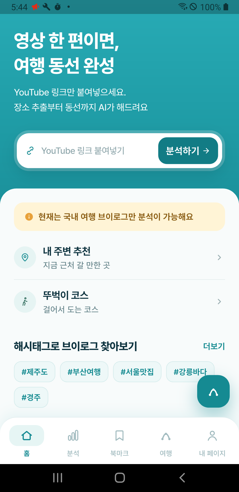
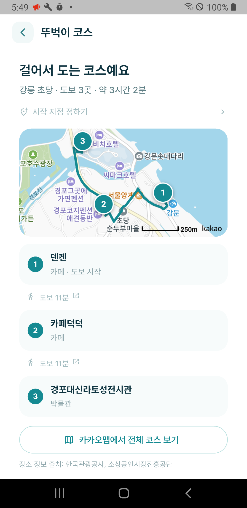
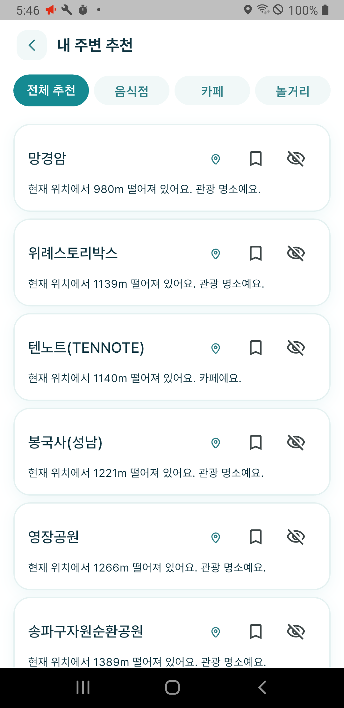

<div align="center">

# Voylog

**유튜브 여행 영상 속 장소를 찾아, 하루 동선까지**

유튜브 여행 브이로그의 자막과 화면 속 글자를 AI가 읽어 영상에 등장한 장소를 자동으로 추출하고,
그 장소들을 숙소 기준 하루 동선으로 최적화해 주는 여행 일정 플래너 앱입니다.

Flutter · Node.js · Python · PostgreSQL · Redis

</div>

---

## 왜 만들었나

여행 계획은 두 단계가 모두 손으로 이루어집니다. 브이로그에서 가고 싶은 곳을 **되감아 가며 받아 적고**, 지도에 하나씩 검색해 저장한 뒤, **어떤 순서로 돌아야 덜 걷는지 감으로** 정합니다.

영상 속 장소는 텍스트로 존재하지 않습니다. 말소리와 화면에 박힌 글자로만 스쳐 지나갑니다. Voylog는 그 두 단계를 서버가 대신합니다 — 링크 하나를 붙여넣으면 장소 추출·좌표 변환·방문 순서 계산까지 자동으로 끝납니다.

## 동작

| 1. 링크 붙여넣기 | 2. 장소 자동 추출 | 3. 하루 동선 완성 |
| --- | --- | --- |
| 유튜브 브이로그 주소 하나만 입력 | 자막과 화면 속 글자를 읽어 장소·좌표로 | 숙소에서 출발해 덜 걷는 순서로 |

<div align="center">
   
</div>

## 주요 기능

- **영상 분석** — 자막에서 장소명·카테고리·영업시간·태그를 추출하고, 타임스탬프를 누르면 영상의 그 장면으로 이동합니다. 공식 자막이 없는 영상은 프레임을 샘플링해 **화면에 박힌 글자를 비전 LLM으로 읽습니다.**
- **AI 동선 최적화** — 시작·종료 숙소를 양 끝점으로 고정한 채 방문 순서만 최적화합니다. 자동차·도보·대중교통에 따라 서로 다른 경로 API로 시간과 거리를 계산합니다.
- **뚜벅이 코스** — 지역만 고르면 서로 도보 거리(1.2km) 안쪽인 장소끼리 묶어 코스를 자동 구성합니다. 구간마다 15분 이하면 도보, 넘으면 버스로 안내합니다.
- **내 주변 추천** — 현재 위치·시각·영업 여부로 정렬하고, 취향을 설정했다면 임베딩 유사도와 학습된 태그 선호도를 더합니다. **없는 신호의 비중은 나머지로 재분배**되어 취향 미설정 사용자가 불리해지지 않습니다.
- **행동 기반 학습** — 조회·북마크·일정 추가·좋아요는 선호를 강화하고, 숨김·관심없음은 이후 추천에서 완전히 제외합니다. 위·경도와 이동 경로는 저장하지 않고 반경 구간만 남깁니다.
- **비슷한 취향 추천** — 취향 벡터 간 코사인 유사도 0.3 이상인 사용자들의 북마크를 협업 필터링으로 모읍니다.
- **공유** — 여행 일정은 공개 링크로, 동선은 피드에 게시해 좋아요와 취향 일치율을 확인합니다. 게시 시 **숙소 정보는 스냅샷에서 통째로 제거**합니다.

요구사항 21개(FR-01 ~ FR-21)를 정의하고 전부 구현했습니다.

## 아키텍처

```
Flutter (travel_youtube_app/)          화면 · 상태관리 · API 호출
        │  REST (JSON)
        ▼
Node.js + Express (backend/)           인증(JWT) · 비즈니스 로직 · DB/Redis
        │  HTTP
        ▼
Python + FastAPI (ai-worker/)          LLM 호출 · 지오코딩 · 경로 · 임베딩 · 점수화
        │
        ▼
OpenAI / Claude / YouTube / Kakao
```

계층을 다른 언어와 프로세스로 나눈 것은 취향이 아니라 제약으로 쓰기 위해서입니다.

- 프론트엔드는 비즈니스 로직을 갖지 않습니다.
- **백엔드는 OpenAI/Claude를 직접 호출하지 않습니다.** LLM 호출이 전부 AI 워커 한 곳을 거치므로 API 키가 한 프로세스에만 있고, 모델을 교체해도 다른 계층은 손대지 않습니다.
- AI 워커는 인증·DB 접근·JWT 발급을 하지 않습니다.

## 기술 스택

| 계층 | 기술 |
| --- | --- |
| 앱 | Flutter (Android/iOS), Provider, Dio, kakao_map_plugin, youtube_player_iframe, flutter_secure_storage |
| 백엔드 | Node.js, Express, PostgreSQL 17, Redis 7, JWT, Kakao OAuth |
| AI 워커 | Python, FastAPI, youtube-transcript-api, yt-dlp, OpenCV |
| 인프라 | Docker Compose(컨테이너 5개), Caddy(HTTPS 자동 발급), 네이버 클라우드 |

## 사용한 API와 데이터

**AI** — OpenAI GPT-4.1-mini(장소 추출·화면 글자 읽기·요약), Claude(전체 폴백), OpenAI Embeddings(장소·취향 벡터)
**지도·경로** — Kakao Local, Kakao Maps SDK, Kakao 길찾기 3종(자동차·도보·대중교통)
**영상** — YouTube Data API v3, youtube-transcript-api, yt-dlp
**그 외** — Kakao OAuth, Firebase Cloud Messaging, SMTP

영상 분석으로만 장소가 쌓이면 분석한 적 없는 지역에서는 추천이 비어 있습니다(테스트 당시 가장 가까운 장소가 10.7km). 그래서 공공데이터 **약 85만 건**을 함께 적재해 콜드 스타트를 해결했습니다.

| 출처 | 규모 | 라이선스 |
| --- | --- | --- |
| 한국관광공사 TourAPI | 약 3만 건 | 공공누리 제1유형 (출처표시) |
| 소상공인시장진흥공단 상가(상권)정보 | 약 82만 건 | 공공누리 제1유형 (출처표시) |

업종 허용목록으로 거르고, 이름이 같고 50m 이내인 장소는 중복으로 보아 정리하며, **월 1회 자동 갱신**으로 폐업한 곳을 지웁니다.

## 디렉토리

```
travel_youtube_app/   Flutter 앱
backend/              Node.js + Express
ai-worker/            Python + FastAPI
database/             마이그레이션 · 스키마
docs/                 기획 · 설계 문서
```

각 디렉토리에 해당 계층 전용 `CLAUDE.md`가 있습니다.

## 실행

```bash
# 앱
cd travel_youtube_app && flutter pub get && cp .env.example .env   # 키 값 채우기
flutter run

# 백엔드
cd backend && npm install && cp .env.example .env
npm run dev

# AI 워커
cd ai-worker && pip install -r requirements.txt && cp .env.example .env
uvicorn app.main:app --reload
```

전체를 한 번에 띄우려면 `docker compose up -d`. 자세한 배포 절차는 [docs/DEPLOYMENT.md](docs/DEPLOYMENT.md).

> API 키는 저장소에 없습니다. `.env.example`을 복사해 직접 채워야 합니다.

## 테스트

```bash
cd travel_youtube_app && flutter test     # 위젯 · 프로바이더 · 리포지토리
cd backend && npm test                    # 서비스 · 컨트롤러 · 리포지토리
cd ai-worker && pytest                    # 추출 · 점수화 · 경로
```

지도·로그인·보안저장소처럼 네이티브 SDK가 필요한 것은 인터페이스 뒤에 두고 테스트에서는 가짜 구현을 주입합니다. 실제 SDK 동작은 `integration_test/`에서 실기기로 확인합니다.

## 팀

**럭키비키** — 김혜빈(팀장) · 최나경
동서울대학교 컴퓨터소프트웨어과 졸업작품

## 데이터 출처

본 서비스는 한국관광공사 TourAPI와 소상공인시장진흥공단 상가(상권)정보를 활용하였으며,
두 데이터 모두 공공누리 제1유형(출처표시) 조건에 따라 이용하였습니다.
